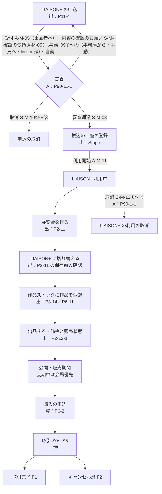
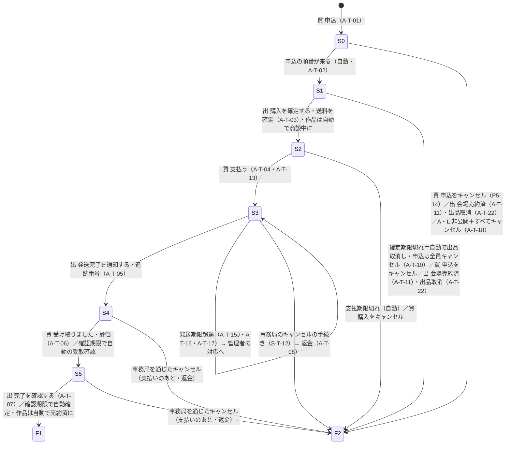

# LIAISON+ の流れ（展覧会の作成から取引の終わりまで）

最終更新：2026-11-13（販売状態の自動の切り替え・メールに対応するお知らせ〔7章〕を反映）

LIAISON+ の取引にかかわる、出品者・購入者（申込者）・管理者の操作と、作品と取引の状態、状態ごとにできる操作、管理者の操作で届くメール・お知らせを、1か所にまとめたもの。**確認と後工程への説明のための見取り図**で、決まりの正本は次のとおり（食い違ったら正本と handoff の新しい方を正とし、この文書を直す）。

| 内容 | 正本 |
|---|---|
| 状態名・ページの呼び方 | `CLAUDE.md`「LIAISON+ 取引状態名」 |
| 期限・状態の帯の書き方・期限のアラート | `docs/transaction-states.md` |
| メールの文面と送るとき | `docs/email-templates.md`・P90-9（テンプレート） |
| サイト内のお知らせ・やること | `docs/notifications.md`・common.js `KTN.NOTICE_DEFS` |
| 管理者の種類と分担・操作の記録 | `docs/admin-roles.md`・`docs/admin-audit-log.md` |
| サービス利用料・キャンペーン | `CLAUDE.md`「LIAISON+ サービス利用料」・`docs/campaign-spec.md` |
| 管理者の手順 | P90-29 管理者マニュアル（L・A の章） |

記号：**出**＝出品者（クリエイター・ギャラリー）、**買**＝購入者・申込者、**E／L／A**＝管理者の種類（E＝一般・L＝LIAISON+ 対応・A＝admin）。メール・お知らせは ID だけ書く（文面は正本）。理由ごとに文面が分かれているメールは、P90-9 で丸数字の枝番が付く（例：S-M-09①〜⑤＝確認依頼の理由ごと）。

**メールの番号**は「送り方-系統-番号」。**A-＝自動**（システムが送る）、**S-＝事務局が手で送る**（テンプレートから）。系統：U アカウント・F フォーム（S- の FQ／FW／FR／FX＝フォームへの回答）・M 機能の申込・E 展覧会・T 取引・C キャンペーン・R リマインダー・N お知らせ・I インサイト・O 見守り・D 削除・P 費用の請求・W 作品・K 注意。末尾 J＝事務局あて。詳しくは `docs/email-templates.md`「メールの番号の付け方」。

---

## 1. 全体の流れ

- 申込の直後に、出品者へ受付（A-M-05）、事務局へ確認の依頼（A-M-05J）が**同時に自動で**届く。審査で内容に不足があれば、事務局がテンプレートから確認のお願い（S-M-09①〜⑤）を送る。
- 展覧会の作成と確認（E：P90-5）は LIAISON（無料）と同じ。展覧会を確認に出すと、事務局へ A-E-03J（add-event@）が自動で届く。LIAISON+ に切り替えられるのは、利用開始（A-M-11）のあとの人だけ。
- 料率と作品の最低価格は、**展覧会の会期の初日**に当たる設定（P90-20）で決まり、その展覧会のすべての取引に使う。
- 購入者として申し込めないアカウント（A が P90-1-1 で「LIAISON+ での購入」を OFF・S-M-13①〜③）は、P6-2 の申込のボタンが押せない。

---

## 2. 取引の状態の流れ

- **取引番号は申込と同時に付く**（申込済にも・追174-432）。取引ワークスペース（P5-15）に入れるのは購入確定待ちから。申込済の申込は購入管理（P5-14）で見る。
- **自動で進む期限**：確定期限・支払期限＝過ぎると自動でキャンセル。受取確認・完了確認の期限＝過ぎると自動で確定。**発送期限だけは過ぎても自動で進まない**（管理者の対応が要る）。
- 期限の長さ（初めの値・**P90-20「取引の期限」で admin が変える**）：確定期限＝会期終了の7日後か申込の7日後の遅い方／支払期限＝購入確定から5日／発送期限＝会期終了の7日後か支払いの7日後の遅い方／受取確認の期限＝発送から5日／完了確認の期限＝受取確認から5日。変えた日数は、保存したあとにその状態になった取引から使う。ガイド・よくある質問の日数もこの設定から出る。
- 取引の連絡（A-T-01〜A-T-25）は通知設定にかかわらず送る。期限が近いのに操作がまだのときは A-T-09（とプッシュ PU-01）。自分の番は「やること」TD-S1〜S5、結果は TD-R1〜R6。それ以外のメールにも、対応するお知らせを出す（7章）。
- **作品の販売状態は取引の状態で自動で変わる**：購入確定待ちまでは販売中（申込を受け付ける）→ 出品者が購入を確定すると商談中（申込を受け付けない）→ 取引完了（完了確認のあと）で売約済。取引が正しくキャンセルされたら販売中に戻る。

---

## 3. 作品（出品）の状態

出品（展覧会と作品の組み合わせ）が持つ状態。作品そのものはニュートラル（価格・販売状態は出品の側）。

| 状態 | 意味 | 買にできること |
|---|---|---|
| 販売中 | オンラインで申し込める | 購入の申込（申込のある作品は「販売中」＋申込の件数） |
| 商談中 | 出品者が購入を確定すると自動でこの状態になる（購入確定待ちのあいだは販売中のまま） | **申し込めない**。取引が正しくキャンセルされたら自動で販売中に戻り、申し込める |
| 売約済 | 売れた。オンラインは**取引完了（完了確認のあと）で自動**、会場は出品者の「会場売約済にする」で | なし |
| 要問合せ | 価格を出さず、問合せで決める | 問合せ（P6-13） |
| 非売品 | 売らない | なし |

これとは別に：

- 販売中・商談中・売約済は、取引の状態で自動で変わる（2章）。出品者が手で選ぶのは、取引の無い作品の販売状態（販売中・要問合せ・非売品など）だけ。
- **非公開**（管理者だけが付ける・P90-12）：作品のページと一覧に出ず、新しい申込を受け付けない。進んでいる取引は続く（5章）。
- **削除**：出品者が削除しても、申込が一度でもあった作品は「削除済み」の印で残る（記録のため）。
- **ロック**：申込や取引がある出品は、価格と販売状態を出品者が変えられない（識別子などは変えられる）。
- 出品者の画面：P2-12-1（出品・価格・販売状態）、P3-15・P4-15（LIAISON+ の展覧会の一覧）、P3-15-1・P4-15-1（展覧会ごとのリエゾン+コンソール＝会場売約済・出品取消）。

---

## 4. 状態ごとにできる操作

| 状態 | 出品者（P3-16・P4-16／コンソール） | 購入者（P5-14・P5-15） | 管理者（P90-13 ほか） | 期限が来ると |
|---|---|---|---|---|
| 出品中（申込なし） | 価格・販売状態を変える／会場売約済／出品をやめる | 申込 | 非公開（L・P90-12）／出品者に連絡（S-W-01〜03）／作品の管理（A・P90-23） | — |
| S0 申込済 | 会場売約済（A-T-11）・出品取消（A-T-22）（申込者全員がキャンセル） | 申込をキャンセル（P5-14） | 非公開して「すべてキャンセル」（A-T-18）か「1件ずつ」（止める・A-T-20）／強制キャンセル（A・A-T-08） | — |
| S1 購入確定待ち | 購入を確定する（送料を確定）／会場売約済（A-T-11）・出品取消（A-T-22） | 申込をキャンセル（P5-15） | 督促（S-T-03）・期限の延長（S-T-08）・一時停止／再開（S-T-09・10）・連絡（S-T-14〜20）・状態の訂正（A・S-T-13）・強制キャンセル（A） | 自動で出品取消し・申込は全員キャンセル（A-T-10・TD-R3／R4） |
| S2 支払待ち | （待つ） | 支払う／購入をキャンセル | 督促（S-T-04）・延長・一時停止・再支払いの案内（S-T-11）・連絡・訂正・強制キャンセル | 自動でキャンセル（A-T-08） |
| S3 発送待ち | 発送完了を通知する（追跡番号） | （待つ）／発送期限を過ぎたらキャンセルを申請（A-T-16） | 督促（S-T-05）・延長・一時停止・**キャンセル申請の処理（S-T-12）**・返金の手続き（L）・連絡・訂正・強制キャンセル | **自動で進まない**（A-T-15J・A-T-16・A-T-17 → ①要対応） |
| S4 受取確認待ち | （待つ） | 受け取りました・評価 | 延長・一時停止・返金・連絡・訂正・強制キャンセル | 自動で受取確認 |
| S5 完了確認待ち | 完了を確認する | （待つ） | 延長・一時停止・返金・連絡・訂正・強制キャンセル | 自動で取引完了 |
| F1 取引完了 | 取引詳細を見る | 取引詳細を見る（領収書） | 返金の手続き（原則受けない）・訂正 | — |
| F2 キャンセル済 | 取引詳細を見る | 取引詳細を見る（購入確定待ちより先でキャンセルになったもの・事由ごとの文） | — | — |

- 支払いのあとのキャンセルは、すべて事務局を通じた手続き（事由ごとの費用の扱いは P60-18 第10条・管理者マニュアル L2〜L6）。購入者が自分でキャンセルできるのは支払いの前まで。
- 当事者はどの状態でも「取引について事務局に相談する」（A-F-08・A-F-08J → P90-21 のお問合わせ・報告）と取引メッセージ（A-T-14）を使える。

---

## 5. 作品が非公開になったとき（P90-12・L 以上）

| いまの段階 | 起きること | 届くメール・お知らせ | 画面 |
|---|---|---|---|
| 申込なし | 作品のページと一覧に出なくなる | 出品者：A-T-19・NT-17 | — |
| 申込済で「すべてキャンセル」 | 申込はすべてキャンセル | 申込者：A-T-18・TD-R2／出品者：A-T-19・NT-17 | P5-14「キャンセル済 - 販売の取りやめ」 |
| 申込済で「1件ずつ決める」 | 申込を止める（P90-13 の①要対応） | 申込者：A-T-20・NT-18／出品者：A-T-19・NT-17 | P5-14 の行に「現在確認中です」 |
| 取引中（S1〜S5） | 取引は続く（止めるなら A の強制キャンセル） | 購入者：A-T-21・NT-19／出品者：A-T-19・NT-17 | P5-15・P3-16・P4-16 の上に1行・作品へのリンクを外す |

- 問題報告から非公開にし、お問合わせ・報告（P90-21）で S-FR-02 を送ったときは、A-T-19 を重ねて送らない。
- **公開に戻したとき**：出品者に A-T-23・NT-20。止めていた申込は元の順で再開し、申込者に A-T-24・NT-21。取引中の購入者に A-T-25・NT-22。

---

## 6. 管理者の操作と、届くメール・お知らせ

| 画面 | 操作 | 管理者 | メール | お知らせ・やること |
|---|---|---|---|---|
| P90-11-1 | 審査通過／確認依頼／申込の取消 | A | S-M-08／S-M-09①〜⑤／S-M-10①〜⑤ | NT-03①〜③ |
| （自動） | 口座の登録が済み、利用開始 | — | A-M-11 | NT-03① |
| P90-1-1 | LIAISON+ の利用の取消（出品者） | A | S-M-12①〜③ | NT-33 |
| P90-1-1 | LIAISON+ での購入の停止（購入者） | A | S-M-13①〜③ | NT-34 |
| P90-12 | 作品を非公開にする | L | A-T-18〜A-T-21（5章） | TD-R2・NT-17〜19 |
| P90-12 | 非公開の作品を公開に戻す | L | A-T-23（出品者）・A-T-24（止めていた申込者）・A-T-25（取引中の購入者） | NT-20・NT-21・NT-22 |
| P90-12 | 作品のことで出品者に連絡する | L | S-W-01〜03 | NT-31 |
| P90-13 | 督促を送る | L | S-T-03〜07（状態ごと） | NT-29 |
| P90-13 | 期限を延ばす | L | S-T-08 | NT-29 |
| P90-13 | 一時停止する／再開する | L | S-T-09／S-T-10 | NT-29 |
| P90-13 | 再支払いを案内する | L | S-T-11 | NT-29 |
| P90-13 | キャンセル申請を処理する（発送期限の超過） | L | S-T-12（完了したら A-T-08） | NT-29（完了は TD-R2） |
| P90-13 | 返金の手続き | L | A-T-08（自動） | TD-R2 |
| P90-13 | 事務局から連絡する | L | 取引メッセージ（S-T-14 で知らせる）か、メール S-T-14〜20 | NT-29（取引メッセージは NT-25 も） |
| P90-13 | お問合わせ・報告をひも付ける・対応に加わる・Stripe で回答済みにする | L | なし（記録だけ） | なし |
| P90-13 | 状態を訂正する | A | S-T-13 | NT-29 |
| P90-13 | 強制キャンセル | A | A-T-08（自動） | TD-R2 |
| P90-14 | 出品者への費用の請求 | L | S-P-01〜03（最後の通知のあとは P90-1-1 で S-M-12①） | NT-30 |
| P90-14 | 振込 | L | A-T-12 | NT-28 |
| P90-15・P90-16 | 注意行為を確認する（種類を選ぶ） | L | なし（記録だけ） | なし |
| P90-15・P90-16 | 注意行為の連絡 | L | 注意行為の種類ごと：S-K-01〜04（出品者）・S-K-05〜06（購入者） | NT-32 |
| P90-21 | 取引の相談に答える | L | S-T-01・S-T-02 | —（相談への回答はメール） |
| P90-20 | 料率・キャンペーン | A（L は見るだけ） | A-C-01・A-C-02 ほか（`docs/campaign-spec.md`） | NT-12・NT-13・NT-16 ほか |
| P90-20 | 取引の期限の日数 | A（L は見るだけ） | なし（操作の記録だけ） | なし |
| （出品者の操作） | 出品取消（P3-15-1／P4-15-1） | — | A-T-22（申込者全員） | TD-R6 |
| （出品者の操作） | 会場売約済にする（P3-15-1／P4-15-1） | — | A-T-11（申込者全員） | TD-R5 |

- メールはすべて P90-9 のテンプレートから始め、送る前に直してよい（E・L・A）。自動のメール（T-・A-M-11 など）は直さずに送る。
- 事務局がテンプレートから送るメールのお知らせ（NT-29〜32）は、種類ごとに1つにまとめ、送ったメールの件名を差し込む（例：「事務局から取引についてのご連絡が届きました（督促：発送）」）。
- 管理者の操作は操作の記録（P90-28）に残る。取引の操作は、その取引の「事務局の対応の記録」にも残る。

---

## 7. メールと、対応するお知らせ・やること（一覧）

メールを送るときは、サイトの中にも対応するお知らせ（あなた宛・NT）か、やること（TD）を出す（2026-11-13 ユーザー指示）。出さないのは、事務局あてと、自分の操作の控えだけ。事務局がテンプレートから送るメールは6章。

| メール | 中身 | 宛先 | お知らせ・やること |
|---|---|---|---|
| A-T-01 | 申込の受付 | 購入者 | NT-23 |
| A-T-02〜A-T-06 | 自分の番が来た（購入確定・支払・発送・受取確認・完了確認） | 番の人 | TD-S1〜S5（やること） |
| A-T-07 | 取引完了 | 双方 | TD-R1 |
| A-T-08 | 取引のキャンセル | 双方 | TD-R2 |
| A-T-09 | 期限が近い（操作がまだ） | 番の人 | PU-01（プッシュ） |
| A-T-10 | 確定期限切れで自動の出品取消し | 申込者・出品者 | TD-R3・TD-R4 |
| A-T-11 | 会場売約済で申込のキャンセル | 申込者 | TD-R5 |
| A-T-12 | 販売代金の振込 | 出品者 | NT-28 |
| A-T-13 | お支払い完了の控え | 購入者 | NT-24 |
| A-T-14 | 取引メッセージ | 相手 | NT-25 |
| A-T-15J | 発送期限の超過（事務局あて） | 事務局 | —（P90-13 の①要対応に出る） |
| A-T-16 | 発送期限の超過（キャンセルを申請できる） | 購入者 | NT-26 |
| A-T-17 | 発送期限の超過 | 出品者 | NT-27 |
| A-T-18 | 販売の取りやめ（非公開・すべてキャンセル） | 申込者 | TD-R2 |
| A-T-19 | 作品の非公開 | 出品者 | NT-17 |
| A-T-20 | 申込の確認中（止めている） | 申込者 | NT-18 |
| A-T-21 | 取引中の作品の非公開 | 購入者 | NT-19 |
| A-T-22 | 出品者の出品取消で申込のキャンセル | 申込者 | TD-R6 |
| A-T-23 | 作品の再公開 | 出品者 | NT-20 |
| A-T-24 | 申込の順番の再開 | 止めていた申込者 | NT-21 |
| A-T-25 | 取引中の作品の再公開 | 購入者 | NT-22 |
| S-M-08・S-M-09①〜⑤・S-M-10①〜⑤・A-M-11 | LIAISON+ の申込の審査・利用開始 | 申込者 | NT-03①〜③ |
| S-M-12①〜③ | LIAISON+ の利用の取消 | 出品者 | NT-33 |
| S-M-13①〜③ | LIAISON+ での購入の停止 | 購入者 | NT-34 |
| A-F-08 | 取引の相談の受付（控え） | 相談した人 | —（自分の操作の控え） |
| A-F-08J | 取引の相談の受付（事務局あて） | 事務局 | —（P90-13 の③相談に出る） |

**事務局に知らせるだけのメール（liaison-info@・対応は不要・2026-11-14 ユーザー指示）**：会期の開始 A-O-05J・終了 A-O-06J、会場売約済 A-T-11J・出品の取消 A-T-22J（どちらも申込の有無にかかわらず送る）、精算下限額の変更 A-T-26J。ほかに、利用者あてのメールのコピーとして、申込 A-T-01・購入の確定 A-T-03・支払い A-T-04・発送 A-T-05・取引完了 A-T-07・キャンセル A-T-08・A-T-10・A-T-18・販売代金の振込 A-T-12 が liaison-info@ にも届く。対応が要るもの（申込の確認依頼 A-M-05J・取引の相談 A-F-08J・発送期限の超過 A-T-15J・キャンペーンの上限 A-C-04J）は liaison@。アドレスの全体は docs/email-templates.md「送信元と送信先のアドレス」。

---

## 8. 管理者が毎日見るところ

- **P90-13「今日の対応」**：①事務局の操作が要る（発送期限超過・止めている申込・一時停止中）／②Stripe で対応（支払いの異議・決済の失敗）／③相談（未対応）／④注意行為（人数・P90-15／P90-16 へ）。表は区分ごとにまとまり、各取引の「取引の詳細と操作」に対応する場所と対応した管理者が出る。
- **P90-15・P90-16「注意行為」**：自動のキャンセルや取りやめが重なる人（目安の回数は A が設定）。
- **P90-14**：振込と、出品者への費用の請求。

---

## 9. 文書を作っていて気づき、決めたこと（2026-11-13）

1. 支払期限・受取確認と完了確認の期限は **5日**。確定期限・発送期限を含め、日数は **P90-20「取引の期限」** で確かめて変える（admin）。
2. 出品者が自分で出品取消ししたときは、申込者全員に **A-T-22**（あなた宛の結果 **TD-R6**）。
3. 非公開を公開に戻したときは、出品者 **A-T-23・NT-20**／止めていた申込者 **A-T-24・NT-21**（元の順で再開）／取引中の購入者 **A-T-25・NT-22**。
4. A-T-11 の送るときの説明を、いまのページ（P3-15-1／P4-15-1 の「会場売約済にする」）に直した。
5. **商談中は申し込めない**。出品者が購入を確定すると自動で商談中になり（購入確定待ちのあいだは販売中のまま）、取引が正しくキャンセルされたら自動で販売中に戻って申し込める。
6. **売約済になるのは取引完了（完了確認のあと）のとき**（と、出品者の「会場売約済にする」）。
7. **メールを送るときは、対応するお知らせかやることも出す**。足したもの＝NT-23〜28（自動の連絡）・NT-29〜34（事務局からのメール・LIAISON+ の取消と購入の停止）・TD-R6（出品取消）。一覧は7章。

